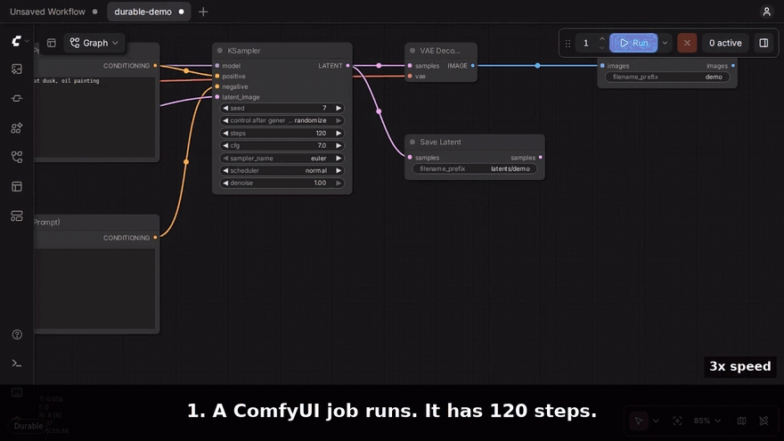

# ComfyUI Durable

**When ComfyUI crashes, your work is not lost.**



This is a real recording, not an animation. We stop ComfyUI with `kill -9` near step 65 of 120. Durable starts ComfyUI again. The job continues at step 65 and completes. Full video: [docs/kill-test.mp4](docs/kill-test.mp4).

## The problem

You put ten video jobs in the queue. Then you go to sleep.

At job four, ComfyUI uses all the memory and stops.

In the morning, the queue is empty. The job that ran is lost. You must start again.

## What Durable does

- **It starts ComfyUI again.** If ComfyUI stops during a job, Durable starts it again with the same settings.
- **It puts your queue back.** The jobs go back into the queue in the same order.
- **It continues the job from the last step.** It does not start the job again at step 1.
- **It keeps finished work.** If the crash occurs after sampling, ComfyUI does not do the sampling again.
- **It tries again after an "out of memory" error.** It makes memory free, then it runs the job again.
- **It gives you a Pause button.** Pause stops the job and makes the GPU memory free. Resume continues the job at the same step.

You do not add nodes. You do not change your workflows. You do not change how you start ComfyUI.

## Install

1. Open a terminal in your `ComfyUI/custom_nodes` folder.
2. Run this command:

   ```bash
   git clone https://github.com/castor639/comfyui-durable.git
   ```

3. Start ComfyUI again.

To make sure that Durable works, look for this line in the ComfyUI log: `[durable] protecting jobs`. You also see a small label in the bottom left corner of the ComfyUI page.

Durable adds no new dependencies. It uses only the Python standard library, and torch, aiohttp and psutil, which ComfyUI already has.

## See it work in 30 seconds

1. Start a long job in ComfyUI. For example, use a KSampler with 100 steps.
2. When the job is at approximately the middle, stop the ComfyUI process. On Linux or macOS, run `kill -9 $(pgrep -f 'main\.py( |$)')`.
3. Wait approximately 10 seconds. ComfyUI starts again by itself. The page connects again by itself. The job continues at the step where it stopped.

We did not test this on Windows.

## What you see

The label in the bottom left corner shows the status:

| Label | Meaning | Button |
|---|---|---|
| `Protected: 2 jobs` | Durable keeps a record of 2 jobs. | **Pause** stops the jobs at their current step. |
| `Paused: 2 jobs` | 2 jobs wait for you. | **Resume** continues the jobs at the step where they stopped. |
| `Durable` | No jobs are in the queue. | No button. |

When Durable does something, a message shows in the top right corner. For example: `Resumed sampling at step 65/120 instead of starting over`.

## What occurs in each case

| Event | Result |
|---|---|
| ComfyUI stops during a job (crash, `kill -9`, all memory used) | Durable starts ComfyUI again. The queue comes back. The job continues at the last saved step. |
| ComfyUI stops during VAE decode | The job does not do the sampling again. It does only the decode. In our test, the job completed 7 seconds after the restart. |
| A node shows a GPU "out of memory" error | Durable makes memory free. Then it runs the job again, a maximum of 2 times. |
| You click **Pause** | The job stops at its current step. The GPU memory becomes free. |
| You click **Resume** | The job continues at the step where it stopped. Paused jobs stay paused when you restart ComfyUI. |
| You stop ComfyUI yourself (Ctrl+C, or a normal `kill`) | Durable does not start ComfyUI again. The next time that you start ComfyUI, your jobs show as paused. Click **Resume** to run them. |

## How Durable does this

- During sampling, Durable saves the current latent to the disk. It does this every 10 seconds (you can change this). The latent is small, a few MB, also for video.
- Durable saves the outputs of normal nodes to the disk: latents, images, masks and text conditioning. The key for each output includes the ComfyUI cache key, and the size and change time of each model file that the output uses.
- Durable writes each job in the queue to the disk.
- A small watchdog process monitors ComfyUI. If ComfyUI stops while jobs are in the queue, the watchdog starts ComfyUI again with the same command line.

## Test results

We ran these tests on an NVIDIA A10G GPU. In each test, we stopped ComfyUI with `kill -9` during sampling. Then we compared the result with a run that had no crash. Both runs used the same seed.

| Sampler | Model | Difference from a run with no crash |
|---|---|---|
| `euler` | SD 1.5 | None. The result is bit identical. |
| `euler_ancestral` | SD 1.5 | None. The result is bit identical. |
| `dpmpp_2m` | SD 1.5 | 0.08% |
| `dpmpp_2m_sde` | SD 1.5 | 0.14% |
| `uni_pc` | Wan 2.1 1.3B video | 1.7%. You cannot see a difference in the frames. |
| `unipc` in WanVideoWrapper | Wan 2.1 1.3B video | 5.3% (31.8 dB PSNR over all frames). You cannot see a difference in the frames. |

Why some samplers give a small difference:

- Ancestral and SDE samplers add random noise at each step. Durable puts the noise generator back to the same position. Thus the result is exact.
- Multistep samplers (`dpmpp_2m`, `uni_pc`, `deis` and others) use data from the last steps. Durable does not save this data. Thus the first step after the restart is less accurate, and the result changes a small quantity.

Other test results:

- Crash during VAE decode: the job completed 7 seconds after the restart, because the sampled latent came from the disk.
- Pause: the GPU memory decreased to 373 MiB. After Resume, the image was bit identical.
- "Out of memory" error (simulated): Durable ran the job again, and the job completed.
- Speed: a 20 step SD 1.5 job took 2.01 s with Durable and 2.01 s without Durable. A Wan 2.1 1.3B job (33 frames, 30 steps) took 153 s with Durable and 152 s without Durable.

## Settings

All settings are optional. To change a setting, set the environment variable before you start ComfyUI.

| Variable | Default | What it does |
|---|---|---|
| `DURABLE_SNAPSHOT_SECONDS` | `10` | The minimum time in seconds between two saves of the sampler latent. |
| `DURABLE_CACHE_GB` | `20` | The maximum size of the disk cache. When the cache is full, Durable deletes the oldest outputs first. |
| `DURABLE_CACHE_ENTRY_GB` | `4` | Durable does not save an output that is larger than this. |
| `DURABLE_OOM_RETRIES` | `2` | The number of times that Durable runs a job again after an "out of memory" error. |
| `DURABLE_WATCHDOG` | `1` | Set to `0` to stop the automatic restart of ComfyUI. |
| `DURABLE_DISABLE` | not set | Set to `1` to stop all functions of Durable. |

Durable keeps its data in `ComfyUI/user/durable/<port>/`. To delete all Durable data, delete this folder.

## Limits

- When the watchdog starts ComfyUI again, ComfyUI runs in the background. On Linux and macOS, the ComfyUI output goes to `ComfyUI/user/durable/<port>/relaunch.log`. To stop this ComfyUI, use `kill <pid>`. Durable does not start ComfyUI again after a normal `kill`.
- Durable continues these sampler nodes at the last saved step:
  - The ComfyUI sampler nodes: KSampler, KSamplerAdvanced and SamplerCustom.
  - The `WanVideoSampler` node from ComfyUI-WanVideoWrapper. Durable uses the `samples` and `start_step` inputs of this node. Wan 2.2 high noise and low noise workflows use the same inputs.
- For WanVideoWrapper, Durable does not continue jobs that use context windows, FreeInit, multitalk, partial denoise or uncommon embed types. These jobs start again at step 1.
- Other custom nodes that have their own sampling loop start again at step 1. Durable still keeps their outputs and puts their jobs back in the queue.
- Some samplers do not give the data that Durable needs at each step (for example `dpm_adaptive`). These samplers run normally, but they start again at step 1 after a crash.
- If systemd, Docker or a different supervisor starts ComfyUI, Durable does not start ComfyUI again. The supervisor does this. Durable only puts the queue back.
- Durable does not write API keys for partner nodes to the disk. After a restart, jobs that use these keys need the key again.
- If you start ComfyUI with `--cache-none`, ComfyUI does not make node cache keys. Then Durable does not save sampler steps or node outputs.
- We did not test Durable on Windows or in the ComfyUI Desktop app.

## License

GPL-3.0. This is the same license as ComfyUI.
